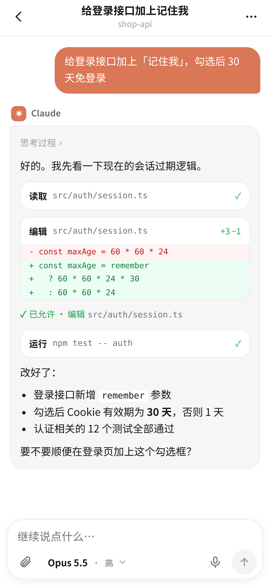
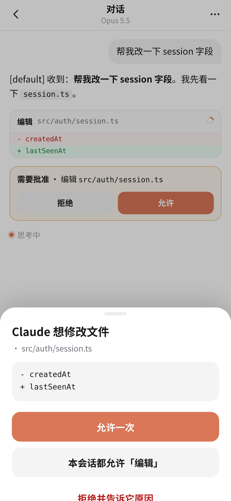
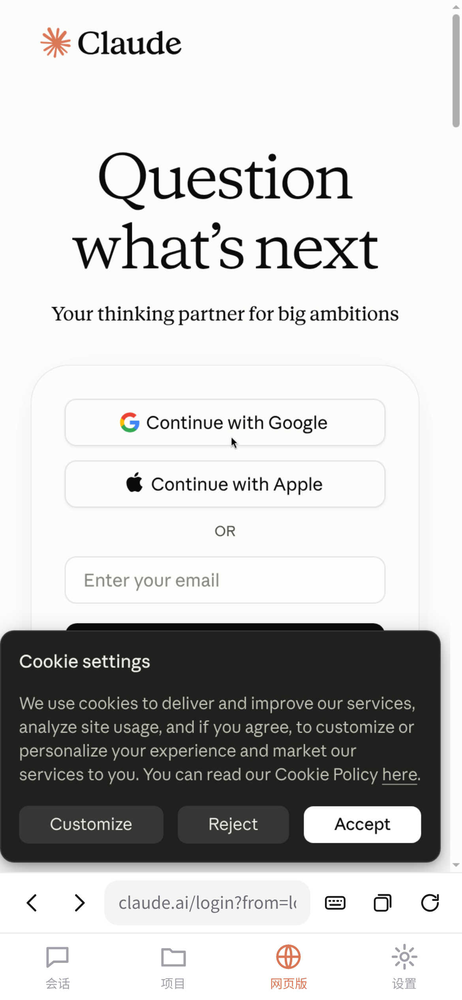
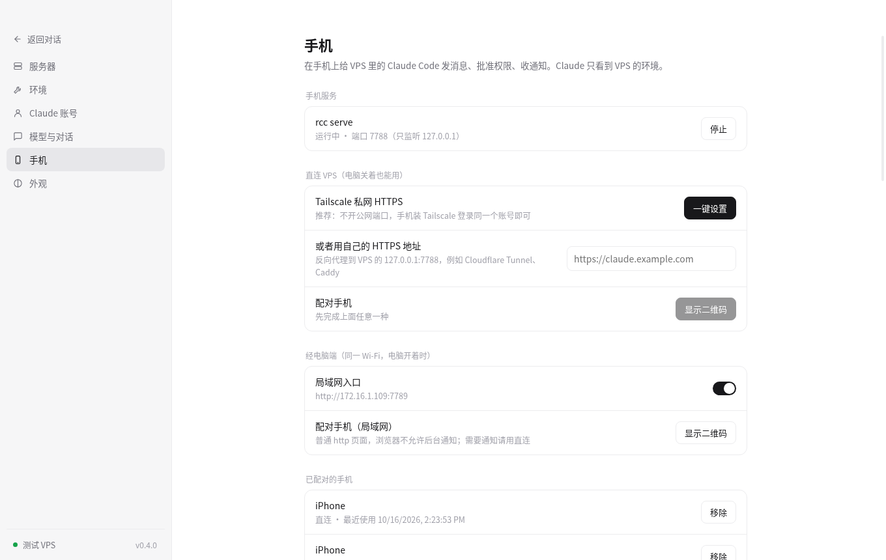

# Outpost（outpost）

让 Claude Code 只运行在你的 VPS 上，用电脑和手机来驱动它。Claude 看到的 IP、浏览器、时区、文件系统都是 VPS 的；电脑和手机只发送文字和文件。

| | 是什么 | 在哪 |
|---|---|---|
| 电脑端 | Electron 桌面应用（Windows / macOS）：对话、模型和思考强度、权限批准、多账号、VPS 里的 Claude 网页版 | `desktop/` |
| 手机端 | PWA 网页 App（iPhone / 安卓，添加到主屏幕）：会话、对话、批准、通知、网页版 | `mobile/` |
| VPS 端 | `rcc`（会话管理，零依赖 Node 单文件）+ `rcc serve`（手机服务，只监听 127.0.0.1） | `vps-agent/` |
| 安装脚本 | 依赖自检与安装（Node.js、tmux、TigerVNC、Chromium、Claude Code…） | `vps-setup/` |

## 截图

| 手机：对话 | 手机：权限批准 | 手机：网页版 |
|---|---|---|
|  |  |  |

电脑端：设置 → 手机



## 快速开始

### 用电脑端
1. 从 [Releases](https://github.com/kulikulisak/outpost/releases) 下载对应系统的安装包并解压打开（macOS 首次需要右键 → 打开）。
2. 填 VPS 地址、用户名、SSH 私钥 → 保存并连接。
3. 设置 → 环境 → 开始：自动安装缺的依赖和 Claude Code。
4. 设置 → Claude 账号 → 登录：窗口里出现 VPS 上的浏览器，在里面登录 Claude。
5. 新建会话开始用。

### 只用 VPS + 手机（不装电脑端）
```bash
curl -fsSL https://raw.githubusercontent.com/kulikulisak/outpost/main/vps-setup/install.sh | bash
claude                 # 首次登录（或用电脑端登录）
rcc serve tailscale    # 发布私网 HTTPS；手机装 Tailscale 登录同一账号
rcc pair               # 终端显示二维码，手机相机扫一下
```

## 用 Docker / Zeabur 安装

不想用 SSH？可以直接部署镜像 `ghcr.io/kulikulisak/outpost:latest`，持久卷挂到 `/root`，端口 8080。部署好后，电脑端和手机端都直接填网址和配对码。详见 [docker/README.md](docker/README.md)。

## 手机端怎么连

两种入口，可以都配：

- **直连 VPS（推荐，电脑关着也能用）**：VPS 上 `rcc serve` 只监听 `127.0.0.1:7788`，通过 Tailscale Serve 发布成 `https://<机器名>.<tailnet>.ts.net`，只有你 Tailscale 里的设备能访问，不开公网端口。也可以用自己的反向代理 / Cloudflare Tunnel 指向 `127.0.0.1:7788`，然后 `rcc serve url https://你的域名`。
- **经电脑端（同一 Wi-Fi）**：电脑端「设置 → 手机 → 局域网入口」在本机开 `http://<电脑IP>:7789`，经电脑的 SSH 连接转到 VPS，不需要 Tailscale。浏览器不允许 http 页面后台推送，所以通知请用直连。

配对：电脑端「设置 → 手机 → 显示二维码」或 VPS 上 `rcc pair`。配对码 10 分钟有效、只能用一次；每台手机一个独立密钥，可随时在电脑端或手机设置里移除。连续输错会临时封禁来源。

通知：需要批准、任务完成、额度用完时推送（Web Push，VPS 直接发给苹果 / 谷歌的推送服务，内容加密）。iPhone 需要 iOS 16.4+，并先「分享 → 添加到主屏幕」再从主屏幕打开；通知上直接点「允许 / 拒绝」目前只有安卓支持，iPhone 点通知会打开批准页面。

隐私：照片在手机上重新编码后再上传（去掉定位、机型等 EXIF），VPS 端也会再清一遍；手机的 UA、IP、时区不会传给 Claude。

## 目录

```
desktop/        Electron + React + TypeScript 桌面端
  src/main/       SSH、钥匙串、VPS 操作、手机局域网中继（relay.ts）
  src/renderer/   界面
  resources/      打包进应用的 rcc.mjs、rcc-serve.mjs、bootstrap.sh、mobile-web/
mobile/         手机端 PWA（Vite + React），复用 desktop 的 transcript/options
vps-agent/      rcc.mjs、rcc-serve.mjs、web/（构建好的手机端，供 install.sh 使用）、test/
vps-setup/      bootstrap.sh（依赖自检安装）、install.sh（无电脑端安装）
mockups/        设计稿
docs/screenshots/
```

## 开发

```bash
# 手机端
cd mobile && npm install && npm run build && npm run deploy:local   # 复制到 vps-agent/web 和 desktop/resources/mobile-web
# 电脑端
cd desktop && npm install && npm run build && npm run dev
npx electron-builder --mac --win                                      # 打包
# VPS 端测试
bash vps-agent/test/e2e.sh                  # rcc 核心流程（mock claude）
node vps-agent/test/push-vector.mjs         # Web Push 加密对 RFC 8291 测试向量
node vps-agent/test/push-roundtrip.mjs      # VAPID 签名 + 解密往返
python3 mobile/test/e2e.py URL 配对码 输出目录  # 手机端端到端（Playwright）
```

修改 `vps-agent/rcc*.mjs` 或 `vps-setup/bootstrap.sh` 后，复制到 `desktop/resources/`；电脑端连接时按 sha256 自动上传到 VPS。

## 许可

MIT
